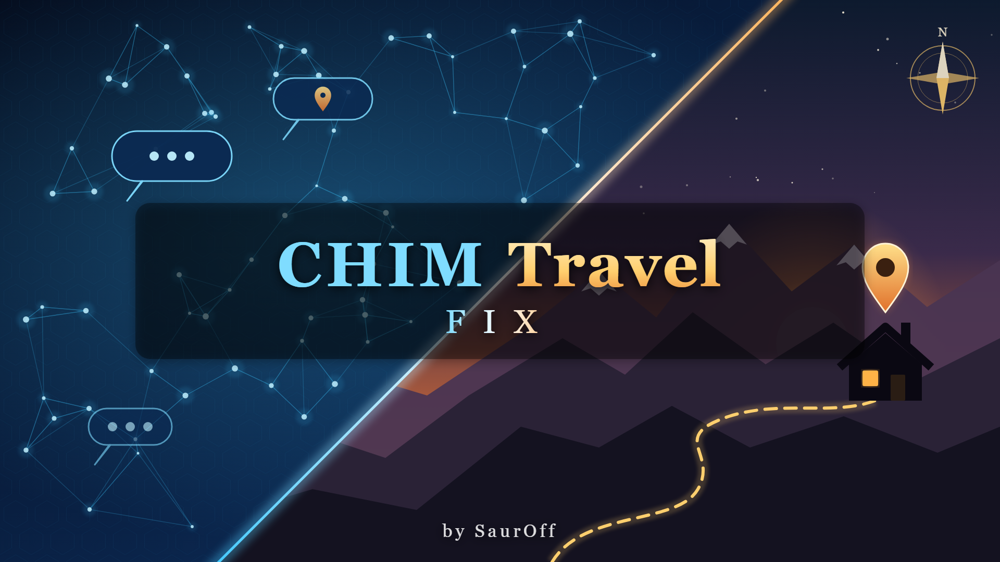

# CHIM Travel Fix

A small mod by **SaurOff** for [CHIM](https://www.nexusmods.com/skyrimspecialedition/mods/126330)
(AI-driven NPCs in Skyrim SE/AE). Agents told to go somewhere ("go to my house in Whiterun and
wait there") walk to the place they named, in any game language, instead of a random place
nearby (often a cave).

> **Nexus page: [CHIM Travel Fix](https://www.nexusmods.com/skyrimspecialedition/mods/198442)** - download the packaged release there.

It is only a CHIM server plugin: no `.esp`, no scripts, nothing in your save. CHIM's own
files are not changed.

- [docs/README.txt](docs/README.txt): the player readme shipped in the archive
- [docs/CHANGELOG.txt](docs/CHANGELOG.txt)
- [docs/CHIM_BUG_REPORT.md](docs/CHIM_BUG_REPORT.md): the bug in CHIM this works around,
  written for CHIM's developers

## The problem

CHIM turns an agent's `Travel_To` into `TravelToRaw@<location form id>` in its action
post-filter (`lib/data_functions.php`). To do that it looks the name up in its `locations`
table with pg_trgm `similarity()`, and that lookup is broken in two ways:

1. **The name query always fails.** It sorts by `created_at`, a column the table does not
   have, so only the second query is used, and that one compares the name with the
   *region*.
2. **Nothing outside ASCII ever matches.** CHIM's database uses `LC_CTYPE=C`, under which
   pg_trgm finds no trigrams in Cyrillic, CJK or accented letters:
   `similarity('Вайтран','Вайтран') = 0`.

With every score at 0, the first row of the table wins, and the agent walks off to a random
place. English games are hit by (1) too; other languages, by both.

## What it does

- Hooks CHIM's `action_post_process_fnct_ex`, which runs **before** that post-filter. It
  matches the place in PHP, in any language, in this order:
  1. the exact name;
  2. "home" or "my house" with a city: the player house in that city;
  3. a name containing what was asked ("Riften" gives Riften's square, not its warehouse);
  4. the closest spelling.
- Hands CHIM an exact `TravelToRaw@<formid>`. CHIM leaves that alone.
- When nothing is close enough, passes `TravelTo@<name>` on as it is (the game plugin
  looks the name up itself), never a random place.
- Adds one line to the player's turn: write place names as the game names them, in the
  game's language, and here are the player houses CHIM knows. The AI often writes the
  English name in a Russian game, or just the city for "my house".
- Logs every lookup to `HerikaServer/log/chim_travel_fix.log`.

## My CHIM mods

| Mod | What it adds | Get it |
|---|---|---|
| **CHIM OStim Bridge** | AI agents start, change and end OStim scenes; reactions, talk and cries of passion during scenes; needs | [Nexus](https://www.nexusmods.com/skyrimspecialedition/mods/194761) · [GitHub](https://github.com/SimpleL97/CHIM-OStim-Bridge) |
| **CHIM ORomance Bridge** | love, partners and marriage (several spouses) through ORomance Plus, married life, children with Fertility Mode | [Nexus](https://www.nexusmods.com/skyrimspecialedition/mods/198436) · [GitHub](https://github.com/SimpleL97/CHIM-ORomance-Bridge) |
| **CHIM Vampire Bridge** | vampires: blood thirst, the bite, Vampire Lords, thralls who obey | [Nexus](https://www.nexusmods.com/skyrimspecialedition/mods/198441) · [GitHub](https://github.com/SimpleL97/CHIM-Vampire-Bridge) |
| **CHIM Travel Fix** (this one) | Travel_To goes to the place the agent named, in any game language | [Nexus](https://www.nexusmods.com/skyrimspecialedition/mods/198442) · [GitHub](https://github.com/SimpleL97/CHIM-Travel-Fix) |

Each works on its own, and none needs another. This one is not connected to the others; it
fixes CHIM's own action. Thralls and spouses of the bridges are often sent somewhere, and
with it they arrive.

## Requirements

[CHIM](https://www.nexusmods.com/skyrimspecialedition/mods/126330), plugin and server
(tested with 3.4.2). Nothing else.

## Repository layout

```
server/
  chim_travel_fix/    the CHIM server plugin (PHP), packaged into the .dwpkg
    ctf_lib.php       matching and the action hook
    functions.php     registers the hook
    prompts.php       the line added to the player's turn
  *.bat, *.ps1        optional manual install / uninstall
tests/test_match.php  matching and hook tests (php tests/test_match.php)
fomod/                installer (info.xml, ModuleConfig.xml, images/banner.jpg)
docs/                 player README, CHANGELOG, bug report for CHIM
art/                  banner generator (make_banner.py, render_banner.ps1) and the banner
build.py              builds the .dwpkg and the release zip (Python 3.8+, standard library)
```

## Building

```
php tests/test_match.php
python3 -I build.py
```

The archive puts `Data/CHIM/server-plugins/chim_travel_fix/<version>.dwpkg` into the game.
CHIM's game plugin (`ServerPluginSync`) uploads it to its server at game start. Every push is
tested and built by `.github/workflows/release.yml`.

## License

[MIT](LICENSE). CHIM belongs to Dwemer Dynamics and is not included here.
